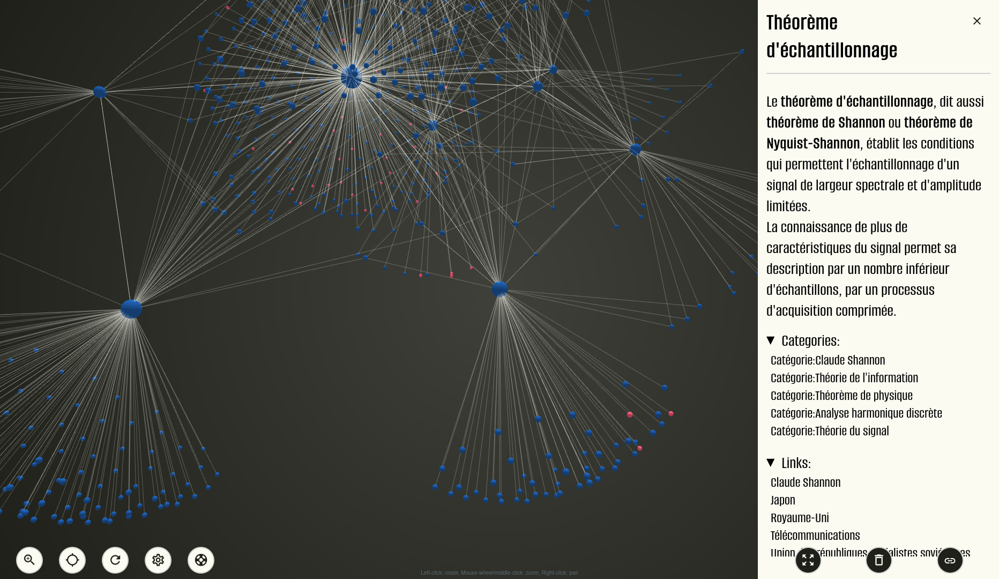

# Wiki-Tree

An interactive 3D visualization of Wikipedia articles and their relationships. Search any article across 300+ languages and explore its connections through categories, internal links, and related pages as a navigable force-directed graph.



**Live demo:** [corbin-c.github.io/wiki-tree](https://corbin-c.github.io/wiki-tree)

---

## Features

- Search Wikipedia in 300+ languages with autocomplete
- Interactive 3D force-directed graph navigation (rotate, zoom, pan)
- Click nodes to focus and view article or category details
- Hover to highlight adjacent connections
- Add new articles to the graph at any time
- Locate existing nodes in the visualization
- Adjustable settings: node repulsion, link curvature, bloom effect, arrow visibility
- Progressive Web App (PWA) support with dark theme UI

---

## How It Works

Wiki-Tree queries the [Wikimedia API](https://www.mediawiki.org/wiki/API:Main_page) to fetch outgoing links, incoming links, categories, and category members for each article. This data is sent to a Web Worker that maintains the canonical graph state (nodes and edges) off the main thread. The worker processes adjacency computations and node/edge CRUD operations, then returns formatted graph data to the React front end, which renders it in real time using `react-force-graph` (Three.js-based 3D rendering).

---

## Architecture

- **App.js** — Root component. Creates the Web Worker and conditionally renders the Splash screen, Graph, Toolbar, and Drawer.
- **Graph component (`src/components/graph.js`)** — Core logic. Uses `WikiAPI` to fetch article data, communicates with the Web Worker, and renders the graph via `ForceGraph3D`.
- **Web Worker (`public/mainWorker.js`)** — Manages graph state and heavy computation off the main thread.
- **WikiAPI (`src/wikiApi.js`)** — Custom client that builds MediaWiki API URLs and handles pagination via async generators.
- **Drawer (`src/components/drawer.js`)** — Right-side panel with views for article info, category info, settings, node locator, and adding new searches.
- **Toolbar (`src/components/toolbar.js`)** — Bottom floating action bar for common actions.
- **Splash (`src/components/splash.js`)** — Landing screen with search autocomplete and language selection.

---

## Tech Stack

- React 17
- Redux (classic `createStore` with `redux-thunk`) for UI state
- `react-force-graph` (wraps `3d-force-graph` / Three.js) for 3D visualization
- Web Workers for off-main-thread graph state management
- Pure CSS with CSS variables for dark theme styling

---

## Getting Started

This is a standard React project.

```bash
npm install
npm start
```

The development server will start at `http://localhost:3000`.

To create a production build:

```bash
npm run build
```

The project is configured for GitHub Pages deployment via the `homepage` field in `package.json`.

---

## Project Evolution

Wiki-Tree did not begin as a 3D React application. The earliest iterations rendered graphs using **d3.js force graph** directly via SVG. The legacy D3 implementation remains in `src/data-graph/` and includes:

- `main.js` — D3 SVG initialization with zoom, node/link rendering
- `worker.force.js` — `d3.forceSimulation` running in a Web Worker
- `class.tree.js`, `class.node.js`, `class.url.js` — Original data structures

The project later migrated to React and Redux, eventually adopting `react-force-graph` (Three.js-based 3D rendering) to replace the original SVG/D3 approach. The worker-based architecture for graph computation was preserved through each transition.

---

## License

GNU General Public License v3.0

Copyright (c) Clément Corbin
